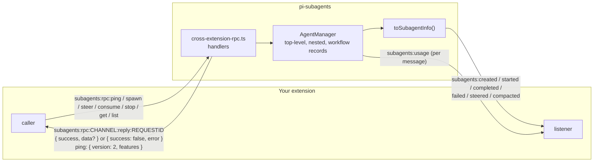
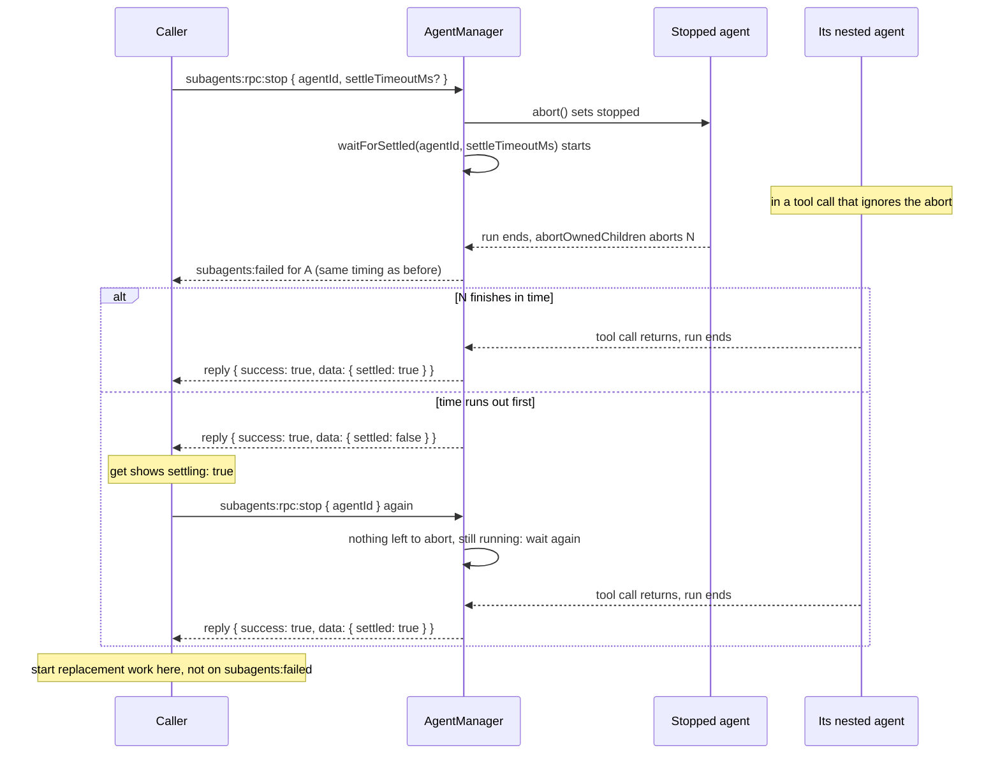
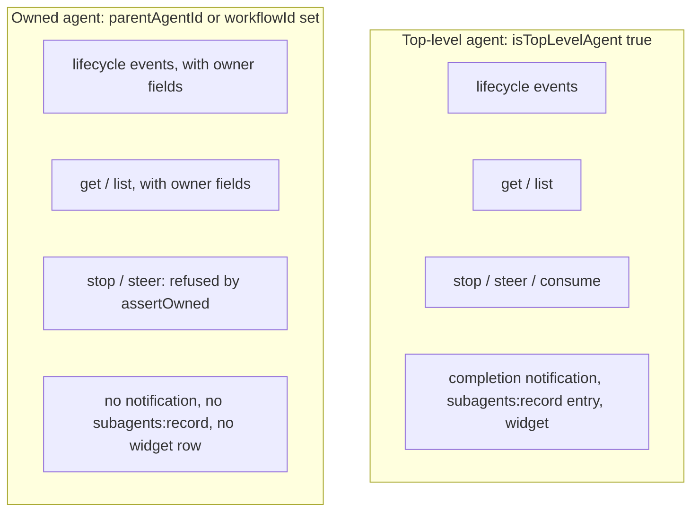
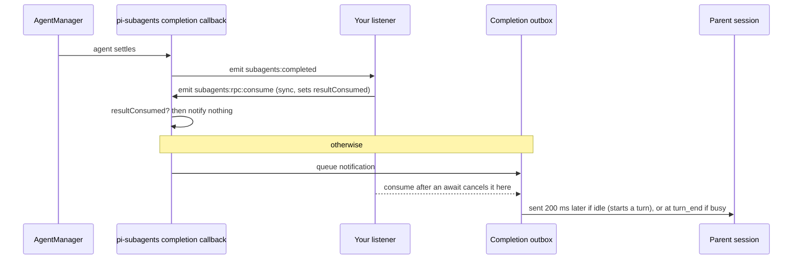
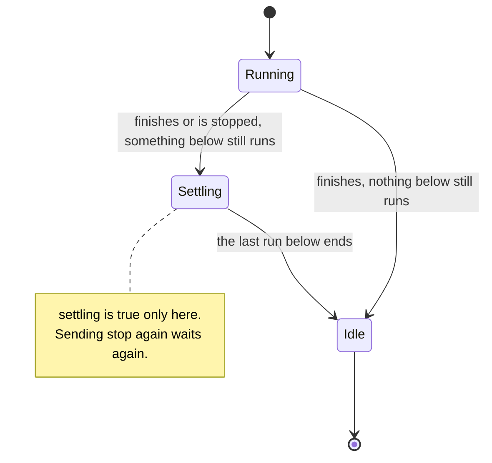
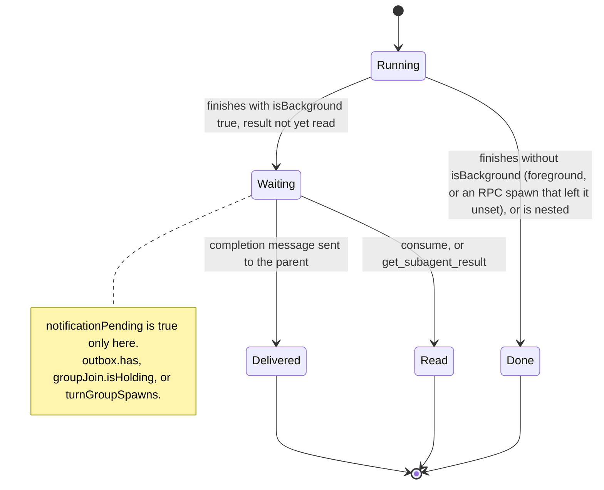

# Driving subagents from another extension

Another pi extension can spawn a subagent, listen for subagent completion, read the result, steer and stop the run — all over the `pi.events` bus, without importing this package directly. Seven request/reply channels (`subagents:rpc:ping`, `subagents:rpc:spawn`, `subagents:rpc:stop`, `subagents:rpc:consume`, `subagents:rpc:steer`, `subagents:rpc:get`, `subagents:rpc:list`), the lifecycle events in README's [event table](../README.md#events), one per-message usage event (`subagents:usage`), one terminal `subagents:disposed`, and one in-process registry at `Symbol.for("pi-subagents:manager")`.

The thing worth understanding up front is that **the bus is in-process.** Every "RPC" call here is a synchronous `pi.events.emit` into the same event loop, and every reply comes back the same way. That single fact explains most of what follows: why `signal` and the `on*` callbacks work on a spawn payload at all, why a `consume` fired inside a `subagents:completed` handler lands *before* the notification decision has been made, and why none of this survives a real process boundary.

For the channel list, the reply envelope, the per-channel snippets and the event table, see [`README.md`](../README.md#cross-extension-rpc). This document is the reference README does not have room for: the complete spawn-option surface, every error string, the notification race, the registry, and what protocol version `2` does and does not promise.

## The surface at a glance

Everything goes through `pi.events`. The lifecycle events push one agent shape, `SubagentInfo` (`toSubagentInfo` in `src/subagent-info.ts`). `get` and `list` return the same shape on request. `spawn`, `steer`, `consume` and `stop` act on an agent. Every request gets its answer on its own `:reply:<requestId>` channel.



## Spawn options

`subagents:rpc:spawn` forwards `options` to `AgentManager.spawn` — but not verbatim. The manager's `spawn` behind the RPC is `spawnTopLevel` in `src/index.ts`, which deletes internal-only fields first, and then `spawnResolved` overwrites the activity-tracker callbacks with its own. The full interface is `SpawnOptions` in `src/agent-manager.ts`; what a bus caller actually gets is three different things.

**Honoured** — set these and they take effect:

| Field | Type | Notes |
|---|---|---|
| `description` | string | What the agent is doing. Shown in the widget, FleetView and the completion notification |
| `name` | string | A memorable second handle (`@auth-audit`). Slugged, never validated — anything unusable degrades rather than failing the spawn |
| `model` | `Model` **or** `"provider/modelId"` | Strings are resolved at the RPC boundary against `ctx.modelRegistry`. `null` means inherit, not override. Resolution is fuzzy — see [Model Scope](../README.md#model-scope) |
| `maxTurns` | number | Turn ceiling for the run |
| `isolated` | boolean | Strips extensions, skills and nested tools. Applies only when the agent file leaves `isolated:` unset — frontmatter is authoritative. **Not** a git worktree — see the trap table below |
| `inheritContext` | boolean | Fork the parent conversation into the child. Only this option decides — an agent file's `inherit_context:` does not apply to RPC spawns |
| `thinkingLevel` | ThinkingLevel | Clamped to what the resolved model supports |
| `isBackground` | boolean | Occupies a `maxConcurrent` slot and queues behind them. Every RPC spawn runs detached regardless; this is what decides whether it is *pooled* |
| `bypassQueue` | boolean | Starts immediately even when the concurrency limit would queue it. The slot is still counted once running |
| `structuredOutput` | CompiledSchema | Makes the child report through a `StructuredOutput` tool |
| `isolation` | `"worktree"` | Temp git worktree, committed to a `pi-agent-*` branch on completion. The agent file's `isolation:` wins: `worktree` applies even when this is omitted, and `off` refuses it |
| `cwd` | absolute path | The agent's tools operate here; `.pi` config still loads from the parent session's project, and the child reports this directory as untrusted (`ctx.isProjectTrusted()` is `false`) |
| `invocation` | AgentInvocation | Resolved snapshot used for UI display |
| `signal` | AbortSignal | Aborting it stops the subagent |
| `onSpawned` / `onQueued` / `onCompaction` / `onBeforeWorktreeCleanup` | functions | Fire as documented on `SpawnOptions` |

**Silently stripped** — set these and nothing happens, with no error and no note. Each deletion is a deliberate guard, and the reasons are worth knowing because they say what the surface refuses to let a caller forge:

| Field | Why it is taken away |
|---|---|
| `parentAgentId` | Ownership. A forged parent hides your agent under someone else's nested tools |
| `workflowId` | A forged value would hide an RPC-spawned agent inside someone else's workflow — and take it out of the concurrency pool with it |
| `depth`, `maxSubagentDepth` | The nesting cap is inherited, not declared |
| `configCwd` | Config-discovery root; only nested launches may set it |
| `rootSessionId` | Names a transcript directory, so a forged value is a path-traversal primitive |
| `resumeSessionFile` | Worse: it names a file to **open and replay** as a conversation. Dispatcher only, and only from a path this extension itself recorded |
| `reclaim` | Bypasses handle allocation, so a forged value would duplicate a live agent's name and make `@handle` ambiguous |
| `blocking` | Every spawn through here is detached. A forged `blocking` would charge it to the foreground pool and defer it behind a queue whose gate nobody is holding |

**Silently overwritten** — `onToolActivity`, `onTextDelta`, `onTurnEnd`, `onSessionCreated` and `onAssistantUsage` are replaced by the activity tracker's own (`spawnResolved`, `src/index.ts`). Every programmatic spawn passes through one funnel so none can supply half-wired callbacks; a half-wired tracker renders worse than none, which is the bug behind a row that reads `thinking…` for an agent's whole life ([#181](https://github.com/tintinweb/pi-subagents/pull/181)).

Four things that are not obvious from the tables:

- **Nothing is required at runtime.** `description` is non-optional in TypeScript and never validated. A spawn with no `options` at all is legal and is what "returns agent id on success" in `test/cross-extension-rpc.test.ts` pins.
- **`bypassQueue` is not stripped.** Its own doc comment scopes it to the scheduler and the `/agents` generator, but a bus caller can set it and skip the `maxConcurrent` check.
- **`structuredOutput` is documented "set only by the workflow host"** (its field comment on `SpawnOptions`) and is also not stripped.
- **`signal` and the `on*` callbacks are function values.** They work only because the bus is in-process. A caller that genuinely serializes its payload cannot use them, and they arrive as `undefined` rather than failing.

### Names that look right and are not

One of these already shipped as a bug in this project's own README example, so it is worth reading the table even if you are sure.

| You might write | What it does | What you meant |
|---|---|---|
| `run_in_background` | Forwarded verbatim and ignored — it is the [`Agent`](../README.md#agent) *tool's* parameter name | `isBackground` |
| `isolated: true` | Disables extensions, skills and nested tools | `isolation: "worktree"` for a git worktree |
| `isolation: "worktree"` | Creates a git worktree | `isolated: true` to strip capabilities |
| `configCwd` | Stripped | `cwd` |
| `max_turns` / `thinking` / `inherit_context` | Ignored — tool and frontmatter spellings | `maxTurns` / `thinkingLevel` / `inheritContext` |
| `memory` | Nothing. **There is no such option** | Memory scope comes only from the agent definition's frontmatter |

**None of these produce an error.** Option keys are not validated on this path at all — unknown ones are accepted and dropped. (Contrast `agent()` inside a [workflow](workflows.md), which rejects unknown keys by name.)

## Errors

Every failure reaches the caller as `{ success: false, error }`, where `error` is `err?.message ?? String(err)` (`handleRpc` in `src/cross-extension-rpc.ts`) — so these strings are what you will actually see.

| Error | Source |
|---|---|
| `No active session` | spawn handler, `src/cross-extension-rpc.ts` — called before the first bound `session_start`, or in a session that excludes pi-subagents |
| `Model override "<label>" provided but ctx.modelRegistry is unavailable` | spawn handler, `src/cross-extension-rpc.ts` |
| `Model not found: "<input>".` + available models | `resolveModel`, `src/model-resolver.ts` |
| `Model not in scope: "<input>".` + allowed models | `checkModelScope`, `src/model-scope.ts` — only with `scopeModels` on, and checked against the *resolved* model |
| `Unknown or disabled agent type: "<raw>". Available: <list>.` | `resolveSpawnTypeIn`, `src/agent-types.ts` — only under `fallbackSubagent: none` |
| `No agent type given. Available: <list>.` | `resolveSpawnTypeIn` — same condition |
| `<reason> The configured fallbackSubagent "<x>" is itself unknown or disabled. Available: <list>.` | `resolveSpawnTypeIn` |
| `SpawnOptions.cwd must be an absolute path: "<value>"` | `assertValidSpawnCwd`, `src/agent-manager.ts` |
| `SpawnOptions.cwd does not exist: "<cwd>"` | `assertValidSpawnCwd` |
| `SpawnOptions.cwd is not a directory: "<cwd>"` | `assertValidSpawnCwd` |
| ``Cannot run with isolation: "worktree" — not a git repo, no commits yet, or `git worktree add` failed. Initialize git and commit at least once, or omit `isolation`.`` | `AgentManager.startAgent`, surfaced through `awaitStartup`. Every git failure ends here: `createWorktree` (`src/worktree.ts`) catches git's own error and returns nothing |
| `Agent not found` | stop handler, `src/cross-extension-rpc.ts` |
| `Agent is owned by another agent or workflow` | stop handler |
| `settleTimeoutMs must be a number of milliseconds` | stop handler — `settleTimeoutMs` is set but is not a finite number. Checked before the abort, so nothing is stopped |
| `Agent is not running` | stop handler. The agent exists, has finished, and nothing below it is still running |
| `Agent not found or still running` | consume handler |
| `Steer message must be a non-empty string` | steer handler — `message` missing, not a string, or whitespace |
| `Agent not found` / `Agent is owned by another agent or workflow` / `Agent is not running` | steer handler — same lookup, ownership guard and settled check as stop |

Three things the table cannot show:

- **The failure that is not an error.** With `worktreeIsolation` off project-wide, `isolation: "worktree"` is dropped by the `isWorktreeIsolationEnabled()` check in `AgentManager.startAgent` with no error, no note on the record, and a success envelope on the wire. Your agent runs in the main tree. If you asked for isolation because two agents were going to write the same files, they now collide and nothing told you.
- **`data` is omitted** when a handler returns nothing, so a successful consume or steer reply is a bare `{ success: true }` and `reply.data.anything` throws. A successful stop replies `{ success: true, data: { settled } }`; see [Stopping](#stopping).
- **`requestId` is not validated.** It is interpolated straight into the reply channel, so a caller that omits it gets its reply on the literal channel `subagents:rpc:spawn:reply:undefined` — where every other caller that omitted it is also listening. Send one, and send a unique one.

## Stopping

`subagents:rpc:stop` aborts the agent, then waits to reply until the agent and every agent below it have finished (`waitForSettled` in `src/agent-manager.ts`, #443). `abort()` sets the status to `stopped` immediately, but a tool call that ignores the abort, such as a file write or a shell command, keeps running until it returns. Without the wait, that write could land on top of replacement work the caller started after the reply.

- **Time limit.** `settleTimeoutMs` on the request caps the wait. It is optional, clamped to `0`..`60000`, and defaults to `STOP_SETTLE_TIMEOUT_MS` (5 s, `src/cross-extension-rpc.ts`). The default stays under the 10 s pi-tasks allows for the stop reply. `0` replies immediately with the current state.
- **`settled: false`** means the time ran out and something may still be running. Agents started while the tree shuts down are waited for too.
- **Sending stop again.** After `settled: false`, `get` shows the agent with `settling: true` (see [Reading agent state](#reading-agent-state)). A second stop finds nothing to abort but something still running, so it goes straight to the wait and replies `{ settled }`. `Agent is not running` means everything has finished.
- **How it tracks runs.** `AgentManager` keeps a set of runs that have not finished (`trackRun`). `isSettling` and `waitForSettled` both read it.
- **Events are unchanged.** `subagents:failed` for the stopped agent still fires when its own run ends, so it can arrive before the stop reply.
- **`reply.success`** means the same as before. `data.settled` is new; a caller that ignores it just gets the reply later.



## Ownership

`isTopLevelAgent(record)` is `parentAgentId === undefined && workflowId === undefined` (`src/agent-manager.ts`). `subagents:rpc:stop` and `subagents:rpc:steer` enforce it through one shared check (`assertOwned` in `src/cross-extension-rpc.ts`): a nested or workflow agent belongs to an agent or workflow that is *waiting on it*, and stopping or redirecting it behind that owner's back makes the owner's step fail. The check matters in practice: the lifecycle events and `subagents:rpc:list` expose every agent's id, nested and workflow ones included, so a caller can name an agent it does not own. Reads (`get`, `list`) have no check.

Two asymmetries to know about, stated as they are:

- **Stop takes an id only**: its `getRecord` is the manager's plain lookup. Consume takes an id *or* an `@handle`: its `consumeResult` (both wired in the `session_start` handler, `src/index.ts`) goes through `resolveAgentRef`.
- **Consume checks `parentAgentId` but not `workflowId`** (`consumeResult`, `src/index.ts`). A workflow-owned agent's result can be marked consumed over the bus even though the same agent cannot be stopped.

The lifecycle events do **not** use this check. `subagents:created`, `:started`, `:completed`, `:failed`, `:steered` and `:compacted` fire for nested and workflow agents too, with `parentAgentId` or `workflowId` set (#442). To see only the session's own agents, ignore events where either is set; up to 0.24 the events carried only those. After the event fires, the `isTopLevelAgent` checks in the `AgentManager` callbacks (`src/index.ts`) still keep nested and workflow agents out of completion messages, the saved `subagents:record` and the widget. A nested or workflow agent sends `subagents:created` when it starts (it is never queued), and again on each resume.

What reaches which kind of agent:



**`subagents:disposed` is the last event of a session.** It is emitted at the end of this extension's `session_shutdown`, after every agent is stopped and every child session has shut down, so no `subagents:usage` can follow it. A listener gets only its synchronous prefix on quit: `pi.events.emit` does not await listeners, and pi calls `process.exit` once the shutdown handlers return. Flush with `writeFileSync`, not `fs.promises`. Fields, and the other events, are in README's [event table](../README.md#events).

**Read a finished agent's report from the final event.** `subagents:completed` and `subagents:failed` carry the shared [agent fields](../README.md#agent-fields). A caller that spawned with `options.structuredOutput` reads the validated report from `structuredJson` and the session file path from `sessionFile`, without the registry. Both are left out when there is no value: `structuredJson` when no schema was passed or no valid report was produced, `sessionFile` when the session was not saved to disk. `structuredJson` is JSON text; `JSON.parse` it.

## The notification race

When a background agent finishes, pi-subagents sends the user a completion notification. If you have already shown the model that result yourself, that notification arrives on top of an answer that was already given, and it costs the parent a turn to dismiss. `subagents:rpc:consume` is how you say you have handled it — the bus-side half of what `get_subagent_result` does when it returns a result.

**When you send it decides whether it works.** The timeline:

1. The agent settles, and the manager's completion callback in `src/index.ts` emits `subagents:completed`.
2. Next, in the same synchronous callback, it checks `record.resultConsumed` and decides whether to notify at all.
3. `pi.events` dispatch is synchronous and in-process, so a handler that emits `subagents:rpc:consume` **without awaiting anything** has already set that flag before step 2 evaluates.



| When you consume | What happens |
|---|---|
| Synchronously, inside your `subagents:completed` handler | The notification is never scheduled. This is the clean path |
| After an `await`, before the notification is sent | Still suppressed. The notification waits in the outbox (`src/completion-outbox.ts`), and consuming the result cancels it there. It is sent about 200 ms after the completion when the parent is idle (`NOTIFICATION_HOLD_MS`), and at the end of the parent's current tool batch when it is busy |
| After it was sent | Too late. pi has queued it with `triggerTurn: true`, and it costs the parent a model call |

Fire-and-forget is the intended use: the reply carries nothing to act on, and the channel sits outside the `subagents:rpc:ping` version handshake on purpose (the comment on the consume handler, `src/cross-extension-rpc.ts`), so you can send it unconditionally and an older pi-subagents with no handler simply keeps notifying.

Consumption is not terminal. An `@handle` steer un-consumes the record (the mention handler, `src/index.ts`) because the agent's reply to that message still needs relaying. A background resume (`AgentManager.resume`) does too, because the record is starting a new run, and so does handing a foreground agent to the background (`AgentManager.sendToBackground`), because its result now has to reach the parent as a notification.

One related thing that lives nowhere else: on every top-level settle, pi-subagents writes a session entry — not an event — via `pi.appendEntry("subagents:record", …)` (the manager's completion callback, `src/index.ts`, and the Agent tool's foreground `resume` branch, which settles inline without that callback; the shape is `AgentRecordEntryData` in `src/agent-record-entry.ts`), carrying `id`, `type`, `description`, `status`, `result`, `error`, `startedAt` and `completedAt`, plus `sessionFile`, `handle` and `alias` when the agent has them, and `worktreeLost: true` when its work lived in a worktree that has since been removed. `get_subagent_result` answers from it once the live record is gone, by id or by the entry's handle or alias. `Agent({ resume })` reopens the agent's session from its id, and the entry also serves cross-extension history reconstruction. It is append-only history, not something to react to.

## Steering a running agent

`subagents:rpc:steer` `{ requestId, agentId, message }` delivers `message` into a running or queued agent's conversation, the bus-side half of the `steer_subagent` tool. It exists for the caller that spawned an agent over the bus and then learns something that agent needs mid-run — a second CI failure on the head it is already fixing, a review that landed while it works — and would otherwise have to choose between spawning a duplicate agent for the same work and dropping the fact.

It takes an id only, enforces the same top-level ownership guard as stop, and answers `Agent is not running` for a record that has settled. A message queued before the agent's session exists is flushed when the session is created, exactly as the tool's steer is. A successful steer emits `subagents:steered` with the agent fields plus `message`, as every steer path does. An older build has no handler and the request times out on your side: check `features.includes("steer")` on the `ping` reply first, or give it a timeout and treat expiry as "not available here".

## Reading agent state

`subagents:rpc:get` `{ requestId, agentId }` replies `{ agent }`. `subagents:rpc:list` `{ requestId }` replies `{ agents }`. Both return the [agent fields](../README.md#agent-fields) the lifecycle events carry, built by the same `toSubagentInfo` (`src/subagent-info.ts`). Use them when your extension loaded after the events it needed had already fired. Detect them with `features.includes("get")` / `"list"` on the `ping` reply.

`list` returns every agent the manager holds, in any status, nested and workflow agents included. Filter on `status`, `parentAgentId` and `workflowId` yourself.

A record stays readable until the manager removes it: 10 minutes after the agent finishes (`cleanup` in `src/agent-manager.ts`), or sooner, at a session start or switch, if its result was consumed (`clearCompleted(true)` keeps records whose result was not read). After that, `get` returns `Agent not found`, and only a top-level agent's saved `subagents:record` session entry remains.

Both add two fields the events do not have. Both are computed when you ask, not stored on the record.

**`settling: true`**: the agent's status is final, but something below it is still running. For example, a stopped agent whose tool call ignored the abort, or a nested agent still shutting down after its parent finished (`isSettling` in `src/agent-manager.ts`). A `{ settled: false }` stop reply leaves the agent in this state. It clears once the last run ends. A running or queued agent never has it, since its `status` already says so.



**`notificationPending: true`**: a finished top-level agent's completion message has not reached the parent yet (`isNotificationPending` in the `session_start` RPC wiring, `src/index.ts`). The message waits in one of three places:

- the completion outbox: 200 ms if the parent is idle, until `turn_end` if it is busy, and through an Esc
- a `group` waiting for the agent's siblings, up to 30 s
- a `group` spawn whose turn has not ended yet

When the message is sent, it starts a parent turn. So while it waits, `hasRunning()` is false and every `status` reads `completed`, yet a turn is still coming. That is the race in [#103](https://github.com/tintinweb/pi-subagents/issues/103). The field is never set once the result has been read (a read result gets no message), or on nested and workflow agents.



The two fields are independent: a stopped background agent can have both set at once. An agent is idle when its `status` is final and neither field is set. The check to run before injecting your own prompt, with `agents` from a `list` reply:

```typescript
const active = agents.some((a) =>
  a.parentAgentId === undefined && a.workflowId === undefined &&
  (a.status === "running" || a.status === "queued" || a.settling || a.notificationPending));
```

## The manager registry

`globalThis[Symbol.for("pi-subagents:manager")]` (`MANAGER_KEY` and `registryEntry`, `src/index.ts`) is a second integration surface — the standard Node cross-package singleton pattern, no bus involved:

| Member | Signature | Notes |
|---|---|---|
| `waitForAll()` | `() => Promise<void>` | Resolves when nothing is running. **All** agents, including ones you did not spawn — a shutdown barrier, not a join |
| `hasRunning()` | `() => boolean` | |
| `spawn(pi, ctx, type, prompt, options)` | `=> string` | **Is** `spawnTopLevel`, so the strip list above applies identically |
| `getRecord(id)` | `=> AgentRecord \| undefined` | Filtered through `isTopLevelAgent`, so someone else's child comes back `undefined` rather than leaking |

The slot is claimed by the first activation only; subagent sessions re-activate this extension in the same process, and unconditionally overwriting would point the registry at a short-lived child manager whose shutdown would then delete the root session's entry ([#128](https://github.com/tintinweb/pi-subagents/pull/128)). Child activations leave it alone, and shutdown releases it only if this activation claimed it (`ownsManagerRegistry`, checked in the `session_shutdown` handler).

Prefer the bus. The registry has no reply envelope, no version, and no availability event — `globalThis[Symbol.for("pi-subagents:manager")] === undefined` is the only probe you get, and it is also `undefined` in a session that filtered pi-subagents out. `subagents:rpc:list` answers *what is still running*, including a finished agent whose notification is still on its way (`notificationPending`) or whose tree is still unwinding (`settling`), and `subagents:rpc:get` hands a record back after its terminal event has passed, both with the public agent fields rather than the live `AgentRecord`. Reach for the registry only for a headless host that wants to block on `waitForAll()` before exiting.

## Protocol versions

`subagents:rpc:ping` replies `{ version: PROTOCOL_VERSION, features: FEATURES }`, with the version currently `2` (`src/cross-extension-rpc.ts`). The constant was introduced already equal to `2` in 0.5.0; "v1" is a retroactive name for the pre-envelope contract, where spawn replied with a bare `{ id }` or `{ error }`, stop replied `{ success: boolean }` with no message, and each handler caught its own errors.

Everything added since kept version `2`, because each addition left existing calls working: stop's ownership check, string-`model` resolution ([#59](https://github.com/tintinweb/pi-subagents/pull/59)/[#60](https://github.com/tintinweb/pi-subagents/issues/60)), `scopeModels` enforcement ([#240](https://github.com/tintinweb/pi-subagents/issues/240)), and the channels and fields below. `features` tells you which of these a build has:

| Feature | Means |
|---|---|
| `consume` | `subagents:rpc:consume` exists |
| `steer` | `subagents:rpc:steer` exists |
| `get`, `list` | `subagents:rpc:get` and `subagents:rpc:list` exist |
| `owned-lifecycle` | The lifecycle events fire for nested and workflow agents too |
| `stop-settles` | The stop reply waits for the work to stop, returns `{ settled }`, and accepts `settleTimeoutMs` |
| `settling` | `get` / `list` set `settling`, and sending stop again while something still runs waits again |
| `notification-pending` | `get` / `list` set `notificationPending` |

Check with `features.includes(...)`. Entries are only ever added, so a feature present today stays present. A reply without `features` comes from an older build. Model scope and stop's ownership check are older than `features` and have no entry.

You can send `consume` without checking: an older build has no handler and just keeps sending the completion message. For everything else, check the feature, and trust any error reply over your own guess.

## Availability

`subagents:ready` is the discovery signal, and both the RPC handlers and the event itself are wired on the first bound `session_start` (its handler in `src/index.ts`) — deliberately not at factory time. pi runs every extension factory *before* applying an agent's `extensions:` filter and only delivers lifecycle events to the survivors, so a factory-time broadcast made a filtered-out session advertise a spawn service it could never provide: `ping` succeeded and every `spawn` answered `No active session` ([#142](https://github.com/tintinweb/pi-subagents/issues/142)).

The consequence is worth stating plainly: **a session that excludes pi-subagents is indistinguishable from pi-subagents not being installed.** It emits no `subagents:ready` and answers nothing. Give discovery a timeout and treat expiry as "not available here" rather than waiting indefinitely. The payload is `{}` — read nothing off it. Handlers are torn down and `rpcHandle` reset in the `session_shutdown` handler, so a later `session_start` re-registers and re-emits.

One more trap on the way in: an RPC-spawned agent emits **no top-level `subagents:created`**. The only three emit sites, all in `src/index.ts`, are the `Agent` tool's `run_in_background` branch, a detached resume (`startBackgroundResume`), and a foreground `Agent` call handed to the background with ctrl+b or the viewer's `b` (`sendForegroundToBackground`). All three fire after the agent's `subagents:started`, unless the spawn queued: each emits `created` only after startup, which is where the manager's start callback emits `started`. Owned agents are announced separately, `created` then `started`, when they start. Your first event for your own agent is `subagents:started` (the manager's start callback), so key your bookkeeping off the id that `spawn` handed you, not off `subagents:created`.

## What the tests pin

This document has no test of its own, so it is worth knowing which claims are actually held in place:

| Test | Level | Pins |
|---|---|---|
| `test/cross-extension-rpc.test.ts` | Mocked `SpawnCapable` | Envelope shape, per-channel error strings (including steer's), model resolution and scope enforcement |
| `test/rpc-lifecycle-gating.test.ts` | Real extension factory | Nothing wired at factory time, everything once at `session_start`, and live widget activity for RPC spawns ([#142](https://github.com/tintinweb/pi-subagents/issues/142)/[#181](https://github.com/tintinweb/pi-subagents/pull/181)) |
| `test/rpc-result-consumption.test.ts` | Real delivery path | The notification firing, and not firing, around `consume` |

Not pinned anywhere, so treat them as descriptions rather than contracts: the `SpawnOptions.cwd` error strings, `subagents:ready`'s `{}` payload, consume's handle resolution, and its missing `workflowId` check.

## Reference implementation

[**`tintinweb/pi-tasks`**](https://github.com/tintinweb/pi-tasks) is the working integration and the one this surface was shaped by. Its `TaskExecute` drives `subagents:rpc:spawn` — including the serialized `"provider/modelId"` string form that the boundary now resolves — and its `TaskOutput` drives `subagents:rpc:consume`, which exists because pi-tasks joins an agent on `subagents:completed` and reports the result itself ([pi-tasks#62](https://github.com/tintinweb/pi-tasks/issues/62)).

Read it for the shape of the whole loop: waiting on `subagents:ready`, keeping an id-keyed map of outstanding spawns, resolving each from the `subagents:completed` / `subagents:failed` handler, and consuming the result in the same synchronous handler that reports it.

If what you want is many coordinated agents rather than one, hand a script to [`SubagentWorkflow`](workflows.md) instead of fanning out over `subagents:rpc:spawn` — and note that a workflow's agents are not yours: you can watch them on the lifecycle events (they carry `workflowId`), but `subagents:rpc:stop` refuses them.
